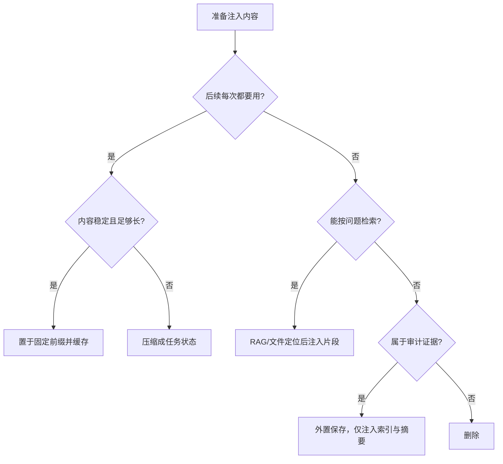

# 上下文窗口与 Token 机制

> 上下文窗口不是“模型记忆”，而是一次推理可访问的工作集。生产系统真正要管的是：**预算、位置、缓存、压缩和可观测性**。

## 1. Token 与上下文预算

Token 是 tokenizer 对输入切分后的离散 ID，不等于字符或单词。代码、JSON、URL、中文、空白的切分效率不同；同一段文本换模型后 token 数也可能变化。任何按“字数×固定系数”估算的方案都只能用于容量预警，计费与硬门禁必须调用厂商 token-count API 或对应 tokenizer。

先把厂商 usage 归一化为完整输入 `effective_input`，再检查模型的预算合同。共享窗口模型的基本约束是：

```text
effective_input + reserved_output + safety_margin <= shared_context_limit
reserved_output <= per_request_output_limit
```

缓存 token 仍占上下文，不要为命中缓存的部分再额外加一次。Claude Messages 的完整输入等于 `input_tokens + cache_creation_input_tokens + cache_read_input_tokens`；OpenAI Responses 的 `input_tokens` 已含缓存读写，`input_tokens_details` 是其分项。两个同名字段不能直接混用。[S1][S2][S3]

历史 thinking 若由服务端保留，已经属于下一轮完整输入，不能再累加历史响应的 thinking 计数。Claude 当前文档说明 Opus 4.5 及以后、Sonnet 4.6 及以后等模型默认保留此前 thinking；更早模型存在自动剥离行为。保留、清理和工具结果回传须按具体合同处理，不能手动拼造签名块。[S1]

输出预算也不等于可见文字：Claude 的 thinking 包含在 `max_tokens` 内。Gemini 4 使用输入、thinking、输出共享窗口，而 Gemini 3/2.5 使用分离的输入和输出预算；后者不应机械套用上面的共享窗口公式。[S1][S5]

### 1.1 能力发现：不是每家 Models API 都返回窗口

2026-11-25 核对官方滚动文档后，采用以下三种取值方式，而不维护一张没有来源和日期的“最新模型表”：

- **API 返回能力字段**：Gemini `models.get` 可读取 `input_token_limit`、`output_token_limit`；还需核模型使用共享窗口还是分离预算，以及流式/非流式输出差异。[S5]
- **API 只有身份字段**：OpenAI `GET /models/{model}` 的公开返回合同包含 ID、创建时间、归属与下线日期，没有窗口容量字段。必须用官方模型文档或托管平台配置补齐，不能看到模型 ID 就推定上限。[S4]
- **官方模型表加部署配置**：Claude 窗口页面列出各型号边界。云平台部署、网关请求体限制、图片页数限制可能更紧，最终使用已核实的有效上限。[S1]

配置应带 provider、endpoint/API、具体 model/deployment、窗口模式、输入/输出/共享上限、来源 URL、核验日期。能运行时读取就交叉验证；读取不到时使用经过审阅的保守配置并报警，不能把未知容量当无限大。模型切换、API切换和 SDK 升级均触发重新验证。

## 2. 长上下文不等于有效上下文

模型能接收 1M token，不代表 1M token 都能被稳定检索和推理。主要退化来自：

1. **位置效应**：关键证据被埋在中部，命中率低于开头/结尾。
2. **干扰效应**：相似但错误的候选越多，模型越容易错误归因。
3. **任务稀释**：指令、工具说明、历史消息和资料争夺注意力。
4. **输出挤压**：输入装满后没有足够的答案或 thinking 预算。
5. **延迟放大**：超长 prefill 增加 TTFT；缓存未命中时尤其明显。

因此应把上下文当成分层缓存，而不是无限日志：

| 层级 | 放什么 | 失效策略 |
|---|---|---|
| L0 固定前缀 | system、稳定工具 schema、安全规则 | 版本变更才失效，优先 prompt cache |
| L1 任务状态 | 当前目标、约束、计划、已验证事实 | 每轮重写为短状态快照 |
| L2 工作证据 | 当前步骤真正需要的代码、文档片段 | 检索后注入，带来源与范围 |
| L3 冷历史 | 完整日志、旧工具输出、大附件 | 外置存储，按需检索，不直接回灌 |

### 2.1 决策树



## 3. Prompt Caching：缓存的是前缀，不是答案

Prompt cache 复用相同 prompt 前缀的 KV 计算。模型仍会生成新答案，随机调用不会因缓存而变成确定性调用。

### 3.1 三家机制对比

以下是 2026-11-25 文档合同，不是本机付费 API 实测：

- **Claude Messages**：顶层 `cache_control` 自动移动断点，或在内容块上显式指定；默认5分钟，可选1小时。最小可缓存前缀取决于型号与平台，短于门槛可能正常返回但不写缓存。观察 `cache_read_input_tokens`、`cache_creation_input_tokens`。[S2]
- **OpenAI Responses**：GPT-5.6及以后支持显式断点；`prompt_cache_options.ttl` 可选 `30m`（默认）或 `12h`。`prompt_cache_key` 在这些模型上主要用于隔离缓存核算，不再是优化路由的必要参数；旧型号仍有不同的路由、保留和计费合同。30分钟和12小时是最低计费覆盖期，不保证每次物理 KV 命中或延迟下降。[S3]
- **Gemini GenerateContent**：2.5及更新模型有隐式缓存。显式 cached content 在3/2.5上仍可使用、默认1小时且有存储时长费用；4 Argon及以后不支持显式缓存，不能沿用旧实现。这里读取 `usage_metadata.cached_content_token_count`，不要混用其他 Gemini API 的 `usage` 字段。[S5][S6]

共同原则：**静态内容放前，动态内容放后**。时间戳、随机 ID、用户输入不能插入静态前缀中间；工具列表或 JSON Schema 改动也可能使后续前缀失配。

### 3.2 接入示意一：Anthropic 自动缓存与指标

下面是需自行安装 SDK、配置凭据和可用模型的接入示意，**本轮未调用真实 API**。缩短后的 `SYSTEM` 仅表达布局，通常达不到缓存门槛；不能把它直接运行后 `read == 0` 判为服务故障。真实审计规则从经过审阅的文件加载，模型由部署配置传入。

```python
import anthropic
import os
from dataclasses import dataclass

client = anthropic.Anthropic()
SYSTEM = """你是代码审计器。以下规则和 CWE 映射固定不变……"""

@dataclass
class CacheMetrics:
    created: int
    read: int

def review(diff: str) -> tuple[str, CacheMetrics]:
    if not diff.strip():
        raise ValueError("diff 不能为空")
    response = client.messages.create(
        model=os.environ["ANTHROPIC_MODEL"],
        max_tokens=4000,
        cache_control={"type": "ephemeral", "ttl": "1h"},
        system=SYSTEM,
        messages=[{"role": "user", "content": diff}],
    )
    usage = response.usage
    metrics = CacheMetrics(
        created=getattr(usage, "cache_creation_input_tokens", 0),
        read=getattr(usage, "cache_read_input_tokens", 0),
    )
    text = "".join(b.text for b in response.content if b.type == "text")
    return text, metrics
```

验收不是“请求成功”，而是满足门槛后连续相同前缀调用出现 `read > 0`。若读写皆零，先查门槛与参数；若一直只有 cache write，再查前缀、工具顺序、TTL及并发冷启动。对相互独立、只共享 system 的 diff 审查任务，显式把断点放在稳定规则后通常比自动缓存整个变动用户消息更容易核算；自动断点更适合不断追加历史的会话。[S2]

### 3.3 接入示意二：.NET 上下文预算门禁

以下为共享窗口的原理示例，本轮未编译 .NET。三个输入分项必须覆盖工具定义、媒体和保留历史，且来自同一完整请求的非重叠口径；分别 tokenize 后简单相加可能漏包装开销。5%与2000 token只是示例余量，不是厂商标准。生产实现还需校验负数、整数溢出与单次输出上限，完整门禁参考下一节。

```csharp
public sealed record ContextBudget(
    int Limit, int ReservedOutput, int SafetyMargin,
    int SystemTokens, int HistoryTokens, int EvidenceTokens)
{
    public int Used => SystemTokens + HistoryTokens + EvidenceTokens;
    public int Available => Limit - ReservedOutput - SafetyMargin;
    public bool IsSafe => Used <= Available;
}

public static ContextBudget BuildBudget(
    int modelLimit, int systemTokens, int historyTokens,
    int evidenceTokens, int reservedOutput = 8_000)
{
    if (modelLimit <= 0) throw new ArgumentOutOfRangeException(nameof(modelLimit));
    var margin = Math.Max(2_000, (int)(modelLimit * 0.05));
    var budget = new ContextBudget(modelLimit, reservedOutput, margin,
        systemTokens, historyTokens, evidenceTokens);
    if (!budget.IsSafe)
        throw new InvalidOperationException(
            $"Context overflow: used={budget.Used}, available={budget.Available}");
    return budget;
}
```

真实管线应在门禁失败后依次执行：删除旧工具原文 → 压缩历史为状态快照 → 缩小 RAG top-k → 降低保留输出预算（仅当产品允许），而不是静默截断头部。

### 3.4 可运行示例：不重算缓存，区分两种窗口

下面的 Python 标准库代码只处理已取得的计数，不实现 tokenizer、不调用模型。`shared_limit=None` 表示官方合同明确为分离预算，**不是容量未知**；调用方负责取得完整请求计数及可信能力配置。缺失 usage 字段抛异常，不把“未知”记成零。

```python
def nonnegative_int(value):
    if type(value) is not int or value < 0:
        raise ValueError("expected non-negative integer")
    return value


def input_total(api, usage):
    if api == "claude_messages":
        fields = ("input_tokens", "cache_creation_input_tokens",
                  "cache_read_input_tokens")
        return sum(nonnegative_int(usage[k]) for k in fields)
    if api == "openai_responses":
        total = nonnegative_int(usage["input_tokens"])
        details = usage["input_tokens_details"]
        read = nonnegative_int(details["cached_tokens"])
        # 旧合同没有写缓存字段；适配器须明确补0后再调用。
        write = nonnegative_int(details["cache_write_tokens"])
        if read + write > total:
            raise ValueError("cache breakdown exceeds total input")
        return total
    raise ValueError("unsupported API contract")


def admit(*, input_tokens, reserve, input_limit, output_limit,
          margin, shared_limit):
    for n in (input_tokens, reserve, input_limit, output_limit, margin):
        nonnegative_int(n)
    if input_limit == 0 or output_limit == 0:
        raise ValueError("limits must be positive")
    if input_tokens + margin > input_limit or reserve > output_limit:
        return False
    if shared_limit is not None:
        nonnegative_int(shared_limit)
        if shared_limit == 0:
            raise ValueError("shared limit must be positive")
        return input_tokens + reserve + margin <= shared_limit
    return True
```

**实例A：批量代码审计的账本归一化。** 教学输入：Claude 普通输入1000、缓存写入2000、缓存读取7000，完整输入为10000。OpenAI 输入10000、明细读取7000/写入2000，也应返回10000，而不是19000。保留原始 usage 与 API 名，再归一化做跨厂仪表盘。即使数值相等，也不能据此比较费用：价格、写入生命周期和输出量不同。

**实例B：长合同问答的输出预留。** 教学配置为输入上限100000、单次输出上限20000、安全余量2000；当前输入90000、预留输出10000。共享窗口100000时门禁拒绝，因为需要102000；合同明确为分离预算时放行。数字只用于边界测试，不对应任何型号，也不是线上容量测量。共享窗口情形优先按条款检索、保留出处，再重新计数；不能为了塞入整份合同静默压低用户要求的答案长度。

**选型依据**：重复分析稳定长材料，优先缓存；问题只依赖少量条款，优先检索；历史过程冗长且要继续执行，优先状态压缩。缓存节省重复计算但不扩窗口，检索可能遗漏证据，压缩可能丢约束，三种方案不能只凭命中率选。对于规则复杂的合同，以留出问题的证据覆盖率、回答质量、任务总成本和可恢复性共同验收。

本轮从最终 Markdown 提取上述函数，30项边界检查通过，2个Python块语法通过；API接入块只做语法检查。这不能解释成缓存命中、云端费用或真实合同回答已验证。

## 4. 压缩与 Compaction

长会话至少需要两类压缩：

- **语义压缩**：把历史重写为目标、约束、决策、未决项、验证结果、文件路径；适合 Agent handoff。
- **机械裁剪**：删除大段工具输出、重复文档和已完成步骤；适合紧急止血。

合格状态快照必须保留：

```yaml
goal: 当前最终目标
constraints: [不可违反的边界]
decisions: [结论及理由]
verified_facts: [带来源的事实]
artifacts: [文件路径、URL、对象ID]
open_issues: [尚未解决的问题]
next_action: 唯一下一步
```

压缩后必须做“可恢复性测试”：新 worker 只拿快照和产物索引，能否继续执行且不重复已完成副作用。不能恢复的摘要只是文案，不是状态。

## 5. Token 成本与容量计算

一次请求成本可拆为：

```text
RequestCost = uncached_input × input_rate
     + cache_write × write_rate
     + cache_read × read_rate
     + output × output_rate
TaskCost = sum(RequestCost) + explicit_cache_storage_cost
```

上述桶必须互斥。OpenAI 的普通输入桶应从总输入扣除读写；Claude 的 `input_tokens` 本身就是普通输入桶。Gemini 显式缓存还需计存储时长，不能只看请求 usage。混合 TTL 写入应分别计价；费率注明每 token或每百万token单位及币种，不把写入费率再次叠在普通输入费上。[S2][S3][S6]

优化顺序：

1. 先减少无效输出，因为输出通常更贵。
2. 再稳定 prompt 前缀，提高缓存命中。
3. 再裁掉重复历史与工具输出。
4. 最后才考虑缩短字段名、CSV 等微优化；可维护性通常比几十个 token 更值钱。

### 5.1 每次发布必须记录的指标

- `input_tokens / output_tokens / reasoning_tokens`
- `cached_tokens / cache_write_tokens`
- 上下文占用率 P50/P95/P99
- 首 token 延迟 TTFT、完整延迟
- compaction 次数与压缩前后 token 比
- 因上下文溢出导致的 retry/失败数
- 单任务 token 成本，而非单请求成本

## 6. 常见错误

- ❌ “1M 窗口就把整个仓库塞进去” → 干扰、延迟、成本同时上升。
- ❌ 用字符数硬门禁 → tokenizer 与多模态 token 会让估算偏离。
- ❌ 缓存命中后以为不占窗口 → 缓存只省计算/费用，不扩容。
- ❌ 动态内容放在前缀中间 → 后续长前缀全部 cache miss。
- ❌ 只摘要自然语言、不保留产物句柄 → 会话无法恢复。
- ❌ 静默截断最早消息 → system 约束或关键决策可能被删。

## 关联知识
- [[10-知识库/AI模型与Agent/01-基础架构与模型底座/1.1-大模型演进与主流架构体系.md]]
- [[10-知识库/AI模型与Agent/02-提示词工程与输出规范/2.1-系统提示词与角色设定.md]]
- [[10-知识库/AI模型与Agent/02-提示词工程与输出规范/2.3-结构化数据输出.md]]
- [[10-知识库/AI模型与Agent/03-工具调用与上下文协议/3.3-RAG系统架构与演进.md]]
- [[10-知识库/AI模型与Agent/04-智能体架构与工作流设计/4.3-记忆机制设计.md]]

## 更新日志

- 2026-11-25：纠正跨厂缓存计数与 Models API 能力发现，更新 Gemini 共享/分离预算及显式缓存边界；保留原有分层和压缩结构，标明 SDK/.NET 示例未实测，补两个工程实例及 Python 纯函数边界测试。未调用付费模型，未测量真实缓存命中、价格或延迟；旧日志保留，不作为本轮验证证据。

| 日期 | 更新内容 |
|---|---|
| 2026-04-08 | 初始骨架创建 |
| 2026-04-14 | 补充 Token、上下文、计费与 Prompt Caching 基础 |
| 2026-08-11 | 按 2026 官方文档重写：移除待验证模型表；补分层上下文、三厂缓存机制、预算决策树、Anthropic 与 .NET 生产示例、compaction 状态规范和观测指标 |

## 本轮权威信源

均于2026-11-25读取官方原文；滚动文档不代表旧SDK或所有托管平台均支持。本轮更新仅覆盖本文，不自动为关联文章背书。

- [S1] https://platform.claude.com/docs/en/build-with-claude/context-windows — 输入拆分、thinking保留及窗口规则。
- [S2] https://platform.claude.com/docs/en/build-with-claude/prompt-caching — 自动/显式断点、门槛、TTL和usage。
- [S3] https://developers.openai.com/api/docs/guides/prompt-caching — 型号分界、TTL、缓存键及互斥计费分项。
- [S4] https://developers.openai.com/api/reference/resources/models/methods/retrieve — Models对象不包含窗口容量。
- [S5] https://aistudio.google.com/docs/tokens.md?generate-content=true — GenerateContent字段与共享/分离预算。
- [S6] https://aistudio.google.com/docs/caching.md?generate-content=true — 显式缓存支持范围和存储费用。
